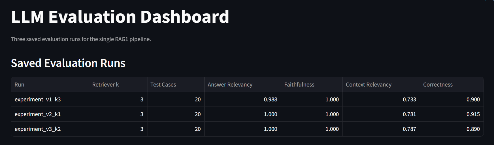
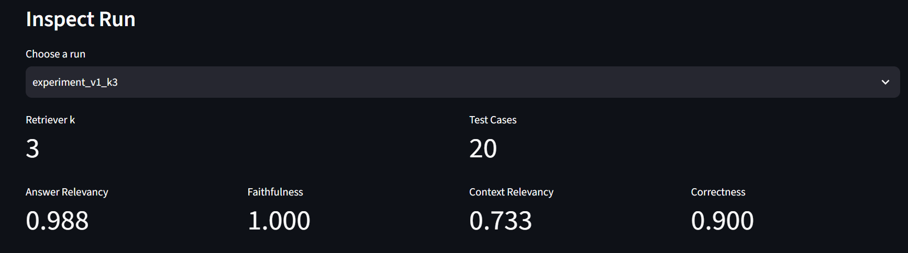
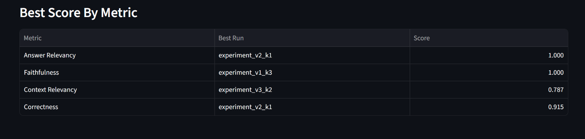
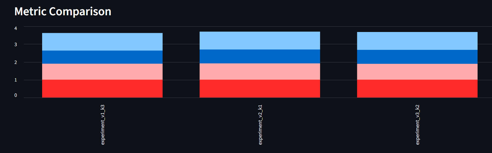

# RAG Evaluation System with DeepEval

An evaluation workspace for a PDF-grounded RAG pipeline. The project indexes
`pdfs/Penguins_ACL.pdf`, retrieves relevant passages, generates structured
answers, and measures answer quality with DeepEval.

The included Streamlit dashboard compares the three saved evaluation runs and
lets you inspect the score for each metric.

## Evaluation results

Each run evaluates **20 test cases**. A metric passes a test case when its
score is at least **0.70**.

| Run | Recorded retriever k | Answer relevancy | Faithfulness | Context relevancy | Correctness |
| --- | ---: | ---: | ---: | ---: | ---: |
| `experiment_v1_k3` | 3 | 0.988 | 1.000 | 0.733 | 0.900 |
| `experiment_v2_k1` | 3 | 1.000 | 1.000 | 0.781 | **0.915** |
| `experiment_v3_k2` | 3 | 1.000 | 1.000 | **0.787** | 0.890 |

| Run | Answer relevancy | Faithfulness | Context relevancy | Correctness |
| --- | --- | --- | --- | --- |
| `experiment_v1_k3` | 20/20 (100%) | 20/20 (100%) | 10/20 (50%) | 19/20 (95%) |
| `experiment_v2_k1` | 20/20 (100%) | 20/20 (100%) | 12/20 (60%) | 19/20 (95%) |
| `experiment_v3_k2` | 20/20 (100%) | 20/20 (100%) | 12/20 (60%) | 19/20 (95%) |

### Key takeaways

- `experiment_v2_k1` has the highest recorded correctness score (**0.915**)
  and reaches perfect answer relevancy and faithfulness.
- `experiment_v3_k2` has the strongest context relevancy (**0.787**).
- Every run is perfectly faithful on the 20 evaluated answers; context
  relevancy is the clearest area for further improvement.

> Note: the saved summary files currently record `retriever_k: 3` for all
> three runs. The run names are retained verbatim (`k3`, `k1`, and `k2`) so the
> README accurately reflects the stored experiment data.

## Dashboard screenshots

### Saved evaluation runs



### Inspecting an individual run



### Best score by metric



### Metric comparison



## Project structure

```text
RAG1/                         RAG pipeline, prompts, indexing, and agent
pdfs/Penguins_ACL.pdf          Source knowledge base
eval_dataset.jsonl             Evaluation questions and expected answers
versions/v1..v3/               Per-run answers, metric results, and summaries
experiment_v1..v3.jsonl        Dashboard-ready aggregate metrics
dashboard.py                   Streamlit results dashboard
compare_experiment.py          Console comparison of saved runs
screenshots/                   Dashboard result captures used above
```

## Run locally

1. Create a `.env` file from `.env.example` and supply the required provider
   credentials (for example, `OPENAI_API_KEY`).
2. Install the locked project dependencies:

   ```powershell
   uv sync
   ```

3. Start the dashboard:

   ```powershell
   uv run streamlit run dashboard.py
   ```

4. To print the saved aggregate comparison:

   ```powershell
   uv run python compare_experiment.py
   ```

## Metrics

The evaluation uses DeepEval with a 0.70 threshold:

- **Answer Relevancy** — whether an answer responds to the question.
- **Faithfulness** — whether an answer is supported by its retrieved context.
- **Contextual Relevancy** — whether the retrieved context is useful for the
  question.
- **Correctness** — whether the answer is factually correct against the
  expected answer.
